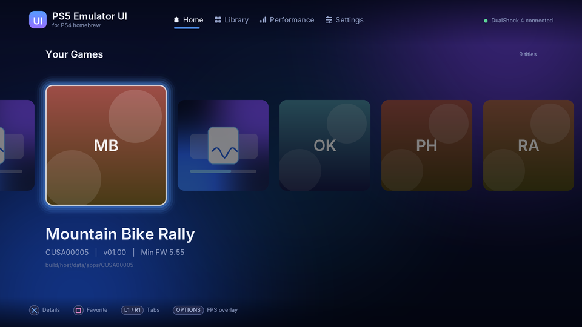
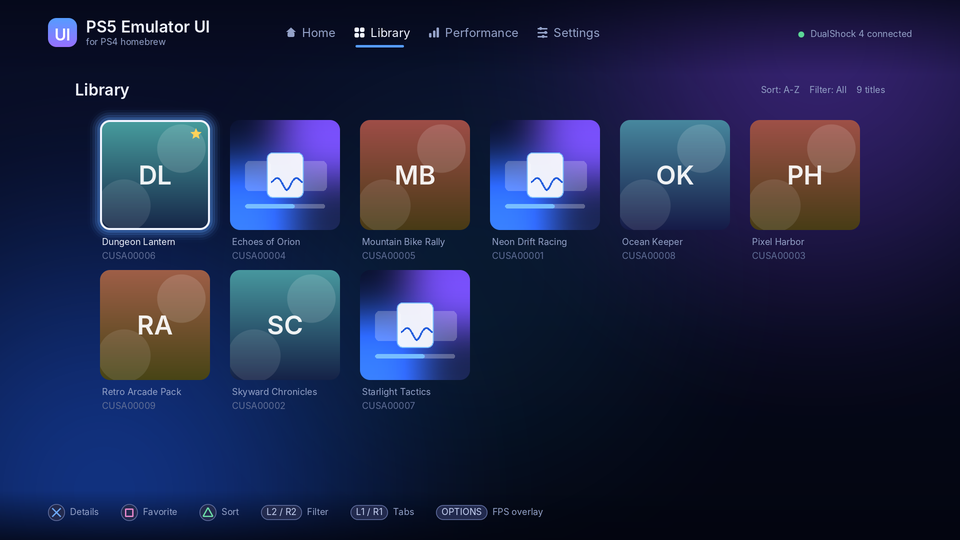
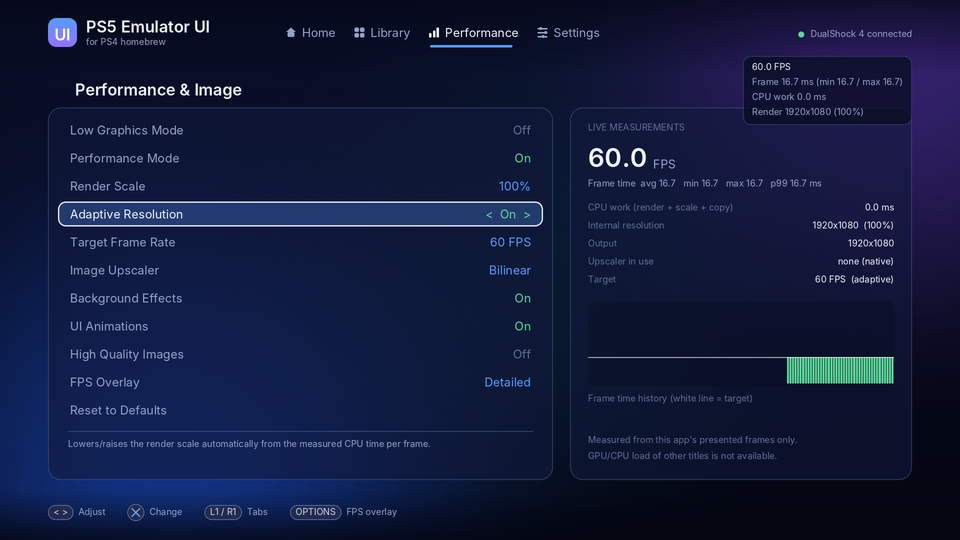

# PS5 Emulator UI for PS4

A **PS5-inspired launcher UI for PS4 homebrew**, written in C++ for the
[OpenOrbis PS4 Toolchain](https://github.com/OpenOrbis/OpenOrbis-PS4-Toolchain).

> **This is NOT a PS5 emulator.** It does not emulate PS5 hardware, cannot run PS5 games, and contains
> no game files, firmware, keys or Sony SDK files. "Emulator UI" in the name only describes the
> look of the interface. The FPS counter shows real measurements of this app, never made-up numbers,
> and there is no AI frame generation.





*(Screenshots are rendered by the desktop test harness; the FPS value shown there comes from the harness's simulated clock.)*

## Features
- PS5-style home carousel, library grid, performance screen and settings, fully controllable with a DualShock 4.
- **Library** of installed PS4 titles: reads `sce_sys/param.sfo` (title, ID, version, min firmware) and `icon0.png`
  from `/user/app` and `/mnt/ext0/user/app`; favourites, hide/show, sort (A-Z, Z-A, ID, most/recently launched), favourites filter.
- **Low Graphics Mode** and **Performance Mode** (rules in `docs/ARCHITECTURE.md`).
- **Image settings**: render scale 50/67/75/100 %, adaptive resolution, Nearest/Bilinear upscaler, cover-art quality, 30/60 FPS flip rate.
- **Real FPS**: presented-frame statistics (FPS, avg/min/max/p99 frame time, frame-time graph, CPU work time).
  If no reliable timer exists the UI says "N/A".
- Pluggable `IUpscaler` interface for future techniques (guide in `docs/ARCHITECTURE.md`).

## Controls
D-pad / left stick move, **X** select, **O** back, **Square** favourite, **Triangle** sort,
**L1/R1** switch tabs, **L2/R2** filter, **OPTIONS** cycles the FPS overlay. Up from the first row focuses the tab bar.

## Build with GitHub Actions (recommended)
1. Push this folder to a GitHub repository.
2. The **Build PKG** workflow runs automatically (or *Actions > Build PKG > Run workflow*).
   It runs the desktop tests, downloads the latest OpenOrbis release, builds, and uploads
   `PS5-Emulator-UI-for-PS4-pkg` (`*.pkg` + `eboot.bin`) as an artifact.
   If the automatic download fails, pass a direct toolchain URL via the workflow input `toolchain_url`
   (or set the repository variable `OO_TOOLCHAIN_URL`).
3. Pushing a tag `v1.0.0` also attaches the PKG to a GitHub release.

## Build locally (Linux)
```bash
sudo apt install clang lld cmake ninja-build python3
export OO_PS4_TOOLCHAIN=/path/to/OpenOrbis/PS4Toolchain     # folder containing link.x
cmake -S . -B build/ps4 -G Ninja -DCMAKE_TOOLCHAIN_FILE=cmake/OpenOrbisToolchain.cmake
cmake --build build/ps4          # -> build/ps4/dist/*.pkg
```
Desktop tests (no toolchain needed): `scripts/host_build.sh` (add `--shots` to render screenshots).

## Install
Install the PKG on a console that can run homebrew PKGs. The app stores data in `/data/ps5ui/`:
`settings.cfg`, `library.cfg`, `library_paths.txt` (one scan folder per line, edit to add more), `log.txt`.

## Verification status - please read
| Part | Status |
|---|---|
| Core logic, library, SFO/PNG parsing, renderer, UI flow, all mode/scale combinations | **Built and tested on desktop** (1389 checks, ASan + UBSan, compiled with `-fno-exceptions -fno-rtti`, C++14/17) |
| `param.sfo`, GP4 writer, packaging script | Tested against a **mock** toolchain only |
| Console back-end (`src/platform/ps4`), CMake toolchain file, real `create-fself` / `PkgTool.Core` command lines | **Not built or run against the real OpenOrbis toolchain or a console** (no network/console in the authoring environment) |

Because of that, the first CI run may need small adjustments. Where it is most likely:
- **Tool flags** in `scripts/package_pkg.sh` (`create-fself`, `create-gp4`, `PkgTool.Core`): on failure CI prints each tool's `--help`.
- **Library names** in `CMakeLists.txt` (`OO_REQUIRED_LIBS`): configure fails with a list of the libs your toolchain has.
- **System call prototypes** in `src/platform/ps4/Ps4Sdk.h` (video-out, pad, direct memory) are written from memory of the public OpenOrbis/Sony API; they are the single place to fix if a signature differs.
- Pad "connected" is inferred from `scePadReadState` succeeding, not from the controller's own flag.
- **Performance on the console is unmeasured.** On a desktop CPU one frame costs about 5 ms at 100 %, 3 ms at 67 % nearest,
  ~8-9 ms with bilinear upscaling; the console CPU is considerably slower. This is why Low Graphics, Performance Mode and
  adaptive resolution exist. Use the Performance screen to see real numbers on your console.
- **Launching titles** from the UI is disabled by default (`-DPS5UI_ENABLE_LAUNCH=ON` enables an experimental
  `sceSystemServiceLaunchApp` call; it is privilege/firmware dependent and unverified).
- The UI is English only (the bitmap font covers printable ASCII). The confirm button is X; consoles configured with O as confirm are not handled yet.

## Legal
MIT licence (see `LICENSE`). Third-party: Inter font (SIL OFL 1.1), see `THIRD_PARTY_NOTICES.md`.
You are responsible for only using this on hardware and software you are entitled to use.

---

## ملخص بالعربية
تطبيق Homebrew لجهاز PS4 بواجهة مستوحاة من PS5، مكتوب بـ C++ لأدوات OpenOrbis. **ليس محاكي PS5** ولا يشغّل ألعاب PS5،
ولا يحتوي على ألعاب أو مفاتيح أو ملفات Sony. عداد FPS يقيس الإطارات الفعلية التي يعرضها التطبيق نفسه فقط (وإذا لم يتوفر مؤقت موثوق يعرض N/A)،
ولا يوجد AI Frame Generation. المكتبة تقرأ الألعاب المثبّتة من `/user/app`، والإعدادات تشمل Low Graphics وPerformance Mode ودقة العرض والـ Upscaler.
للبناء: ارفع المجلد إلى GitHub وشغّل workflow باسم **Build PKG**؛ الناتج يظهر كـ Artifact. راجع قسم **Verification status** أعلاه:
الكود اختُبر على الحاسوب، أما الربط الفعلي مع OpenOrbis وتشغيله على الجهاز فلم يُختبر بعد وقد يحتاج تعديلات صغيرة في أول بناء.
